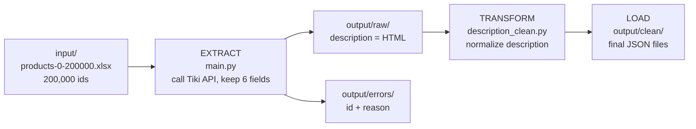

# Tiki Product Crawler

Download **200,000 products** from the Tiki API with plain Python, keep 6 fields,
normalize the product description, and save everything as JSON files.
Every id ends up either as a product or as an error with its reason, and a check script
proves that nothing is missing or duplicated.

The goal was to solve a real data collection task,
and to make the long run (about 3 days) safe: it can be stopped at any time and continued,
and every problem is logged.

## Result

| | Count |
|---|---|
| Product ids in the input list | 200,000 |
| Products downloaded | 124,299 |
| Errors (all `404 not found`: the product no longer exists on Tiki) | 75,701 |
| Products + errors | **200,000** (0 missing, 0 duplicates, 0 extra) |
| Descriptions still containing the Tiki tax sentence after cleaning | 0 |
| Empty descriptions after cleaning (original had only the tax sentence or only images) | 1,744 |

These numbers are printed by `check_data.py` on the full data.
Each product keeps 6 fields: `id`, `name`, `url_key`, `price`, `description`, `images_url`.

## Pipeline (ETL)



| Step | Script | Input | Output |
|---|---|---|---|
| 0. Check the API | `check_api.py` | 1 product id | screen: status, Content-Type, 6 fields |
| 1. **Extract** | `main.py` | `input/products-0-200000.xlsx` | `output/raw/products_NNN.json`, `output/errors/errors_NNN.json` |
| 2. **Transform + Load** | `description_clean.py` | `output/raw/` | `output/clean/products_NNN.json` |
| 3. Check the data | `check_data.py` | input + all output | screen: counts and checks |

- **Extract**: call the API for each id, keep 6 of the 59 fields. The description stays as raw HTML.
- **Transform**: turn the HTML description into clean text (see below).
- **Load**: write the final JSON files to `output/clean/`, same file names as `output/raw/`.

Raw and clean data are kept in separate folders: if a cleaning rule changes, only
`description_clean.py` is run again (about 1.5 minutes), not the download (3 days).

### Input

`input/products-0-200000.xlsx`: one column `id`, 200,000 rows, 0 empty, 0 duplicates.

### Output

| Folder | Files | Content |
|---|---|---|
| `output/raw/` | `products_001.json` ... `products_200.json` | downloaded products, description as raw HTML |
| `output/errors/` | `errors_001.json` ... `errors_200.json` | `{"id": ..., "reason": ...}` for each id that failed |
| `output/clean/` | `products_001.json` ... `products_200.json` | same products, description normalized |
| `output/crawl.log` | | time + message for every chunk and every retry (not on GitHub) |

File number N contains the ids number `(N-1)*1000+1` to `N*1000` of the input list.

## Project structure

```
├── input/
│   └── products-0-200000.xlsx   list of product ids
├── output/                      only one sample file per folder (full data: see below)
│   ├── raw/products_001.json
│   ├── clean/products_001.json
│   └── errors/errors_001.json
├── check_api.py                 step 0: test the API with one product
├── main.py                      step 1: download (checkpoint + retry + log)
├── description_clean.py         step 2: normalize the description
├── check_data.py                step 3: check input and output
├── test_main.py                 tests for main.py (fake API, no internet)
├── test_clean.py                tests for the cleaning rules
├── requirements.txt
└── README.md
```

## How to run

```bash
# Install (Python 3.10)
python3 -m venv .venv
source .venv/bin/activate
pip install -r requirements.txt

# Run the tests (about 1 second, no internet needed)
pytest

# Run the pipeline, in this order
python check_api.py            # 2 seconds: is the API working?
python main.py                 # about 3 days; stop with Ctrl+C, run again to continue
python description_clean.py    # about 1.5 minutes
python check_data.py           # check the result
```

All commands are run from the project folder.

## Checkpoint: what happens when the run stops

The 200,000 ids are split into 200 chunks of 1,000. A chunk is finished when its file
`output/raw/products_NNN.json` exists. When `main.py` starts, it skips every chunk that
already has its file. So after a stop (Ctrl+C, power cut, lost internet), running
`python main.py` again continues from the first unfinished chunk. At most one chunk
(about 25 minutes) is downloaded again.

Two details make this safe:
- The errors file is written first and the products file last, so "the products file exists"
  really means "the whole chunk is saved".
- Each file is written to a `.tmp` file first and then renamed. The rename happens completely
  or not at all, so a file is never half written. A leftover `.tmp` only means a run stopped
  while writing; `check_data.py` reports it.

## Failure handling

| Problem | How it is detected | What `main.py` does | What I do |
|---|---|---|---|
| Product does not exist | status `404` | save as error `404 not found`, no retry | nothing (normal) |
| Tiki blocks us (too fast) | status `200` but Content-Type is HTML, not JSON | wait and retry: 30, 60, 90, 120, 150 s | nothing; if it happens often, increase `SLEEP` |
| Server error, timeout, lost internet | other status, or an exception | wait and retry, up to 5 tries | nothing |
| Still failing after 5 tries | | save as error with the reason, continue | see next line |
| Errors that are not 404 | `check_data.py` shows other reasons | | delete that `products_NNN.json`, run `main.py` again |
| Script stopped | | finished chunks are safe on disk | run `main.py` again |
| API changed or blocked for a long time | `check_api.py` does not print OK | | wait, run `check_api.py` again before `main.py` |

Every retry and every finished chunk is written to `output/crawl.log` with the time,
so a 3 day run can be checked afterwards.

## Tests

```bash
pytest
```

12 tests, no internet needed:
- `test_main.py`: `extract()` keeps exactly the 6 fields; a product without images gives `[]`;
  `fetch()` returns the product on success; a `404` is not retried. A fake session replaces
  the real API, so the tests are fast and always give the same result.
- `test_clean.py`: one example for each cleaning rule (no description, HTML tags, `&amp;`,
  CSS and video, invisible characters, empty lines, Tiki tax sentence, Vietnamese NFC).

## Design decisions

- **`curl_cffi` instead of `requests`**: with `requests`, Tiki answers `403`. It recognises
  Python by the way it opens the secure (TLS) connection. `curl_cffi` with
  `impersonate="chrome"` opens the connection like the Chrome browser.
- **1 second pause**: in a test with no pause, Tiki blocked us after about 10 requests, for
  several minutes. With a 1 second pause the test requests were not blocked, and the full run
  went through.
- **Success = status 200 AND JSON**: when Tiki blocks us it still answers `200`, but with an
  HTML page. Checking only the status would save wrong data.
- **Chunks of 1,000 ids**: little work lost after a stop, and only 200 files to handle.
- **Keep the raw HTML, clean later**: the download is slow, and cleaning rules may change.

## Description normalization

`clean_description()` in `description_clean.py`:
1. removes HTML tags, CSS (`<style>`) and videos (`<iframe>`), one block of text per line;
2. turns HTML codes into characters (`&amp;` becomes `&`);
3. removes invisible characters (non-breaking space, zero-width space, BOM);
4. uses one Unicode form for Vietnamese letters (NFC);
5. removes empty lines and the sentence "Giá sản phẩm trên Tiki đã bao gồm thuế..." that
   Tiki adds to every product.

Known limitation: 30 products (0.02%) still contain tag-like text, because the shop typed it
as text or the source HTML is broken. They were left as they are.

## Full data

The full output is about 680 MB, too big for GitHub, so the repo only has one sample file per
folder. The full data is on Google Drive:

| File | Content | Size |
|---|---|---|
| [tiki_products_raw.zip](https://drive.google.com/file/d/13dodYNIV-6C-5cercohJcriPA0DuqWN4/view?usp=drive_link) | 200 files, description as raw HTML | 99 MB |
| [tiki_products_clean.zip](https://drive.google.com/file/d/12GjZI05yLXcFPNsDQLcODiqBlatQ92K1/view?usp=drive_link) | 200 files, description normalized | 75 MB |
| [tiki_errors.zip](https://drive.google.com/file/d/1qkSejIVINj_R3DpVPeW1t5Ot2y7W_bPq/view?usp=drive_link) | 200 files, failed ids + reason | 460 KB |

After unzipping, put the files in `output/raw/`, `output/clean/` and `output/errors/`.

## Possible improvements

- Find the shortest safe pause to make the download faster (the run is limited by the pause,
  not by the computer).
- Handle the 30 descriptions with broken HTML.
- Save the result to a database if the data has to be queried.
